# scan-unseeded-accumulator: state diagram

> Generated from the canonical model by npm run generate. Do not edit this projection.

Finite control-state projection; stored data and guards remain in the table. Edges are not timing assertions.

```mermaid
stateDiagram-v2
    state "Unsubscribed" as s0
    state "Empty" as s1
    state "Active" as s2
    state "Calling" as s3
    state "Closed" as s4
    [*] --> s0
    s0 --> s1 : SCAN-INIT-UNSEEDED subscribe [fresh execution]
    s1 --> s2 : SCAN-FIRST source.next [first source value; no seed supplied]
    s2 --> s3 : SCAN-CALL source.next [index < Number.MAX_SAFE_INTEGER]
    s3 --> s2 : SCAN-RETURN callback.return [outcome identifies the pending invocation]
    s3 --> s4 : SCAN-THROW callback.throw [outcome identifies the pending invocation]
    s1 --> s4 : SCAN-EMPTY-COMPLETE source.complete [no pending reducer]
    s1 --> s4 : SCAN-EMPTY-ERROR source.error [no pending reducer]
    s1 --> s4 : SCAN-EMPTY-CANCEL cancel [between resolved value reactions]
    s2 --> s4 : SCAN-ACTIVE-COMPLETE source.complete [no pending reducer]
    s2 --> s4 : SCAN-ACTIVE-ERROR source.error [no pending reducer]
    s2 --> s4 : SCAN-ACTIVE-CANCEL cancel [between resolved value reactions]
```

